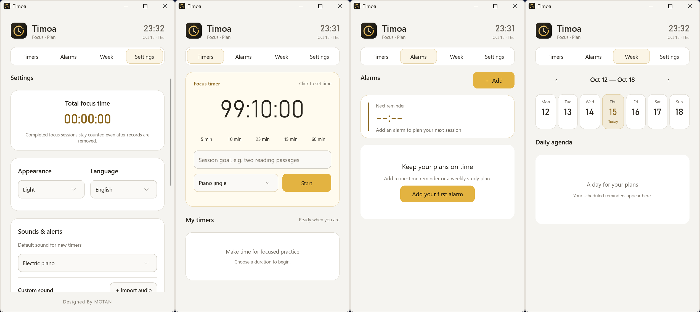

<h1 align="center">Timoa</h1>

A lightweight countdown timer, alarm clock and focus timer for Windows.

<a href="README.md">简体中文</a> · <a href="https://github.com/mofan6/Timoa/releases/latest">Download</a> · <a href="https://github.com/mofan6/Timoa/issues">Issues</a>

## Download

**Windows 10/11 x64, Windows 7 SP1+ x64, and Windows 7 SP1+ x86.** No separate .NET, VC++, Java or WebView2 runtime installation is required.

Current version: **1.1.5**. See [release notes](RELEASE-NOTES.md).

| System | Portable EXE | Installer |
| --- | --- | --- |
| Windows 10 / 11 · x64 | [Timoa.exe](https://github.com/mofan6/Timoa/releases/download/v1.1.5/Timoa.exe) | [Timoa-Setup.exe](https://github.com/mofan6/Timoa/releases/download/v1.1.5/Timoa-Setup.exe) |
| Windows 7 SP1+ · x64 | [Win7-x64.exe](https://github.com/mofan6/Timoa/releases/download/v1.1.5/Timoa-1.1.5-Win7-x64.exe) | [Win7-x64-Setup.exe](https://github.com/mofan6/Timoa/releases/download/v1.1.5/Timoa-1.1.5-Win7-x64-Setup.exe) |
| Windows 7 SP1+ · x86 | [Win7-x86.exe](https://github.com/mofan6/Timoa/releases/download/v1.1.5/Timoa-1.1.5-Win7-x86.exe) | [Win7-x86-Setup.exe](https://github.com/mofan6/Timoa/releases/download/v1.1.5/Timoa-1.1.5-Win7-x86-Setup.exe) |

The [complete source archive](https://github.com/mofan6/Timoa/releases/download/v1.1.5/Timoa-1.1.5-source.zip) contains separate normal and Windows 7 source trees, licenses and corresponding audio-decoder source. Compatibility development is also maintained in the [windows7 branch](https://github.com/mofan6/Timoa/tree/windows7).

Windows 7 packages have been compiled and statically inspected, but have not been run on Windows 7 hardware or a VM. The x86 build requires SSE2. Earlier releases remain available from [GitHub Releases](https://github.com/mofan6/Timoa/releases).

Keep the portable EXE in a permanent location before enabling startup at sign-in. Re-enable startup if you move it.

## Features

- Multiple countdowns with pause, resume and restart; 5, 10, 25, 45 and 60-minute presets and custom durations down to seconds.
- Phone-style time wheels controlled with the mouse wheel, dragging or arrow keys.
- Optional Single focus and Stopwatch modes, both off by default. Starting or resuming either stopwatch or countdown pauses the other and preserves progress.
- A resizable, always-on-top mini window showing the active timer and alarms due within 30 minutes.
- One-time and recurring alarms, weekday/weekend/custom schedules, end times and optional five-minute warnings.
- Eight built-in sounds, including Fireworks Festival and At Twilight with 0.8-second fade-ins and fade-outs, and multiple custom sounds with individual preview and removal. Import common unencrypted MP3, FLAC, M4A, OGG, WAV and other audio files with offline conversion.
- Automatic countdown loops with adjustable breaks and three customizable next-round presets. Expected finish time is shown in countdown cards and the mini window.
- Daily completed focus duration, rounds and hourly charts with a fixed 60-minute scale, plus persistent lifetime totals. Paused time is excluded.
- Dark/light themes and three embedded languages: Simplified Chinese, Traditional Chinese and English. Simplified Chinese is the default.
- Focus-page shortcuts: tap `M` three times within one second to start, resume or begin another round; press `N` to pause.
- System tray, `Ctrl + Alt + T`, optional startup at sign-in, and JSON backup/restore.

Closing the window keeps timers running in the tray. Use the tray menu to exit the application.
Alarms cannot sound while the computer is shut down, asleep or the application is not running.

## Data and backups

JSON backups contain plans, settings and focus statistics. **Custom audio files are not included.** A pre-import snapshot is saved as `data-before-import.json` before restoring a backup.

For compatibility with earlier TIMO versions, user data remains in `%APPDATA%\TIMO`. Custom audio is stored in its `sounds` folder and may be backed up separately. Decoder files are cached in `%LOCALAPPDATA%\TIMO\codecs`; importing audio does not require a network connection.

Uninstallation preserves user data. Exit an older version from the tray before running the new one.

## Build and licenses

Built with Rust and Slint 1.18.1, with a statically linked language runtime. See [the build documentation](docs/BUILDING.zh-CN.md) for toolchain and packaging details.

Application code is licensed under [Apache-2.0](LICENSE). See [NOTICE.txt](NOTICE.txt), [licenses](licenses) and [third-party/FFmpeg](third-party/FFmpeg) for third-party notices and corresponding decoder source.

Backup and Windows startup paths were reviewed in source code before release. They were not verified by actually restoring backups, changing startup settings, installing/uninstalling or restarting Windows.

## Keywords

Windows countdown timer, alarm clock, desktop timer, focus timer, study timer, exam preparation, productivity, time management, lightweight, portable, multilingual.

倒计时、计时器、电脑闹钟、专注计时、学习计时、刷题限时、考研、提醒、时间管理。

## Acknowledgements

Thank you to [@malinfossum](https://github.com/malinfossum) and [Tidsro](https://github.com/malinfossum/tidsro) for the initial inspiration and the six original chimes.

感谢 [@malinfossum](https://github.com/malinfossum) 的 Tidsro 项目，提供了 Timoa 最初的灵感与六段基础铃声。

Designed By MOTAN

